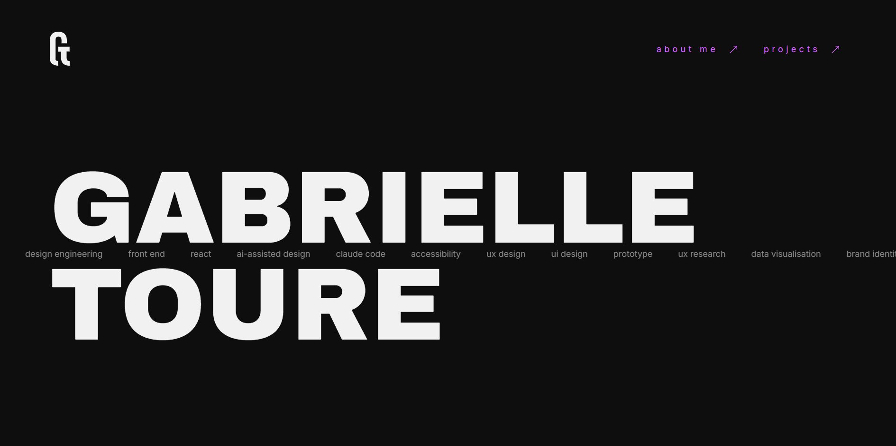

# Gabrielle Touré

This is Gabrielle Touré's portfolio, live at https://gabrielle-toure.netlify.app



## How it's built

- React 18 with React Router 6
- Vite 5
- Bootstrap 5 (CSS only, for layout and utility classes)
- Designed in Figma. Colours and type are Figma variables, carried over as CSS custom properties.
- Deployed on Netlify

Designed and built from scratch, without a template.

## Working with AI

I designed the site in Figma, with Figma AI and the Figma connector, and built it with Claude Code. I decide the structure, the components and the rules. AI speeds up the repetitive work and helps me bring the designs to life in code.

## Design decisions

- The scrolling keywords on the home page are one list, rendered twice and moved by a CSS animation so the loop has no end. It is hidden from screen readers and stops for people who prefer reduced motion.
- Small reusable components (Nav, Footer, NavLink, Ticker), with all design tokens in one file, `tokens.css`.
- Links show a visible purple focus outline for keyboard users, and the current page is marked with `aria-current`.

## Run it locally

```bash
npm install
npm run dev     # http://localhost:5173
npm run build
```

Contact: [LinkedIn](https://www.linkedin.com/in/gabrielle-toure/) or toureegabrielle@gmail.com
